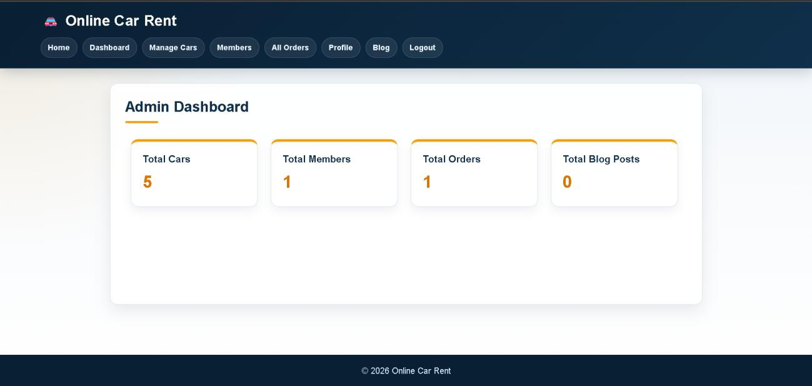
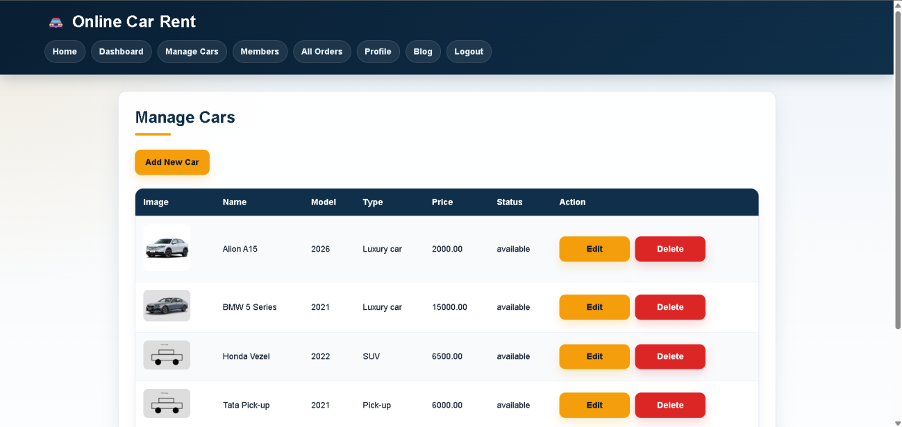
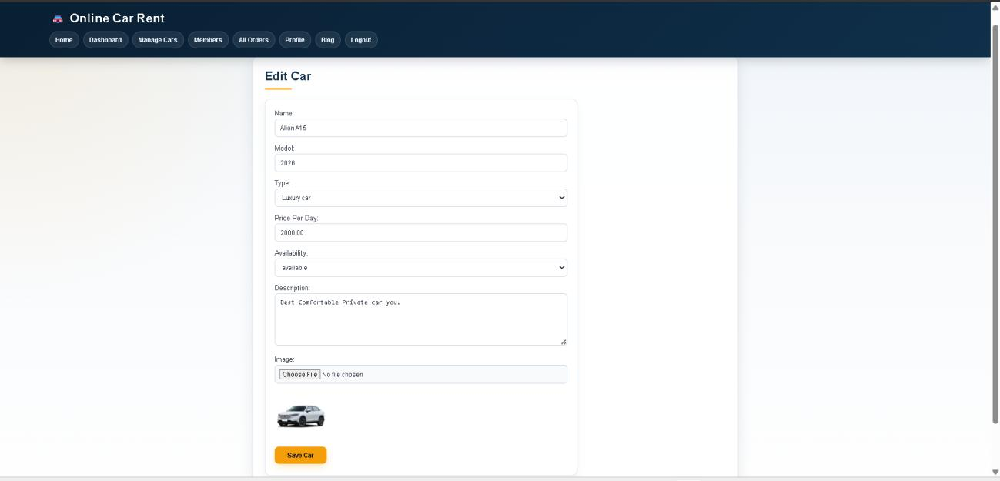
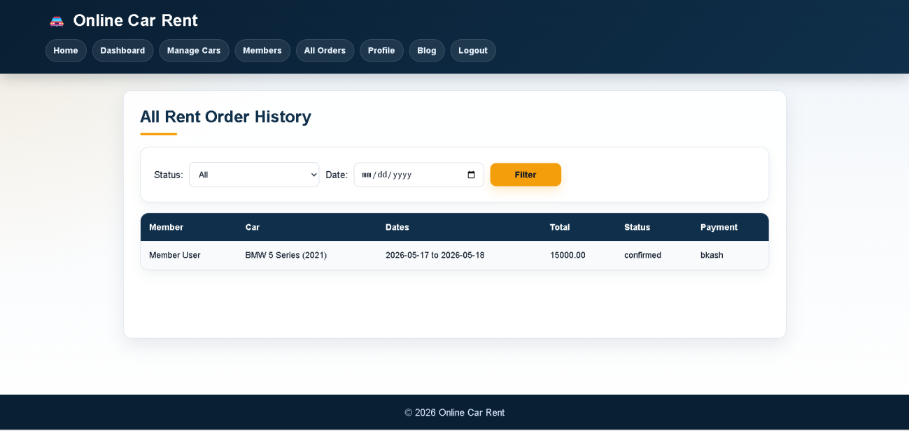
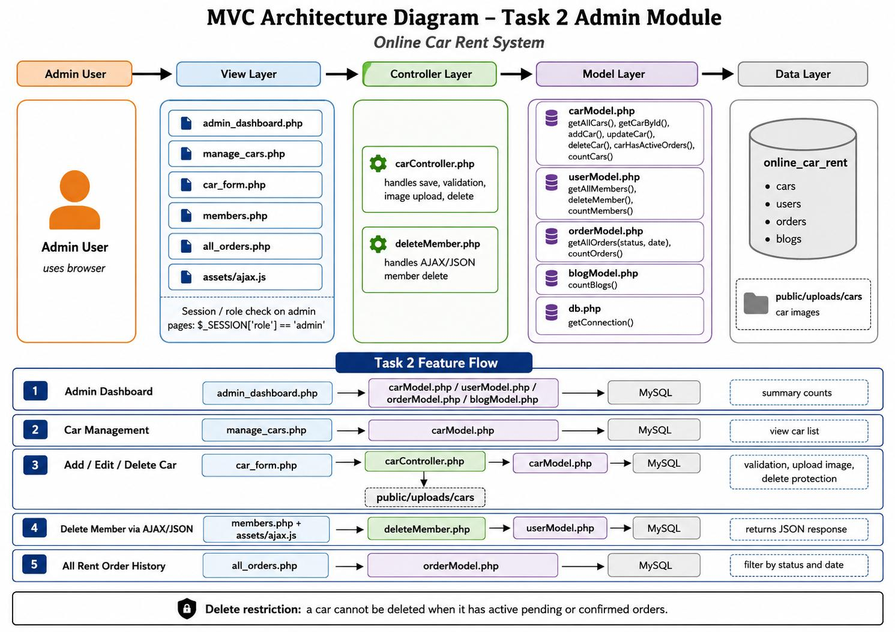

# Online Car Rent

**A car rental web application built with PHP, MySQL and JavaScript.**

Online Car Rent was developed for the **Web Technologies (CSE 4101)** course at **American International University-Bangladesh (AIUB)**, Spring 2025–2026. It brings car listings, rental orders and account management together in a multi-tier web application with separate **Admin** and **Member** roles.

This repository contains the group project. My assigned work focused on the administrative module: managing cars, removing member accounts and reviewing rental orders.

<p align="center">
  
</p>

## What the system does

**Members** can browse listed cars, place rental orders, use the project's payment flow, review their rental history and share experiences through blog posts.

**Admins** manage the car inventory, member accounts and rental order records through a role-restricted dashboard.

### Admin features

| Feature | Details |
| --- | --- |
| Dashboard | Summary cards for cars, members, rental orders and blog posts. |
| Car management | Add, edit, view and delete car listings, including model, type, daily price, availability and description. |
| Image uploads | JPG/PNG images with MIME-type and 2 MB size validation. |
| Delete protection | Prevents car deletion while pending or confirmed orders reference that car. |
| Member management | Removes member accounts using AJAX/JSON and updates the table without a full-page reload. |
| Rental order history | Displays member, car, dates, total cost, order status and payment method, with status and date filters. |

## Screenshots

<table>
  <tr>
    <td width="50%"><br /><sub><b>Car inventory</b> — view and manage listings</sub></td>
    <td width="50%"><br /><sub><b>Car editor</b> — update details and images</sub></td>
  </tr>
  <tr>
    <td colspan="2"><br /><sub><b>Rental history</b> — filter orders by status and date</sub></td>
  </tr>
</table>

*Screenshots were taken from the Spring 2025–2026 course project report.*

## Technology stack

| Area | Technology |
| --- | --- |
| Frontend | HTML, CSS, JavaScript |
| Backend | PHP |
| Database | MySQL / MariaDB |
| Database access | MySQLi with prepared statements |
| Authentication | PHP sessions and role checks |
| Dynamic requests | AJAX with JSON responses |
| Local environment | Apache and MySQL through XAMPP |
| Version control | Git and GitHub |

## Project organization

The project follows the PHP MVC-style separation used in the course: **views** render pages, **controllers** process requests and validation, and **models** communicate with the database.

The principal files documented for the admin module are:

```text
views/
  admin_dashboard.php     # Admin summary
  manage_cars.php         # Car list and actions
  car_form.php            # Add/edit car form
  members.php             # Member management
  all_orders.php          # Rental order history
controllers/
  carController.php       # Car creation, updates, uploads and deletion
  deleteMember.php        # AJAX member deletion endpoint
models/
  carModel.php            # Car queries
  userModel.php           # Member queries
  orderModel.php          # Rental order queries
  blogModel.php           # Blog statistics
assets/
  ajax.js                 # Member deletion request
public/uploads/cars/      # Uploaded car images
```

The following diagram illustrates how my admin module connects the view, controller, model and data layers:



## Running locally

The project was developed with **XAMPP (Apache + MySQL)**. You will need PHP with the MySQLi extension and a MySQL/MariaDB database.

1. **Clone the project** into the web-server directory, such as XAMPP's `htdocs` folder:

   ```bash
   git clone https://github.com/ArafatJamil254/online-car-rent.git
   ```

2. **Start Apache and MySQL** from the XAMPP Control Panel.
3. **Set up the database** in phpMyAdmin (`http://localhost/phpmyadmin`). The coursework architecture names the database `online_car_rent`. Import the matching SQL export from the project if one is available. If your checkout does not contain an SQL export, you will need the project's database schema and test data before database-backed pages can work.
4. **Configure the database connection** in the project's `db.php` or equivalent connection file. Use your own local host, database name, username and password; do not commit real credentials.
5. **Check the upload directory:** PHP should be able to write to `public/uploads/cars/` for car image uploads.
6. **Open the project** at `http://localhost/online-car-rent/` when the folder is named `online-car-rent`. If your checkout uses a different entry script or folder, adjust the URL accordingly.
7. Sign in using an **admin account from your local test database** to access the administrative pages.

> **Setup note:** The course report documents the database structure and application flow, but does not establish the exact SQL dump filename or the entry-point filename in the current GitHub checkout. Those details may need to be checked against the repository before the project can run from a fresh clone.

## My contribution

I worked on **Task 2 — Admin: Car Management (CRUD), Delete Members, and View All Rent Order History**.

My work included:

- Building the admin dashboard's summary view.
- Implementing car creation, editing and deletion with server-side validation and image upload checks.
- Protecting cars with active rental orders from being deleted.
- Connecting the member list to an AJAX/JSON deletion endpoint.
- Retrieving rental order history with status and date filters using parameterized MySQL queries.
- Integrating the module into the group's shared MVC-style structure.

The task was developed on the branch `feature/task2-23-54253-3` and integrated through a pull request, as documented in the coursework report.

## Validation covered in the course report

The submitted report records checks for admin-only access, required car fields, positive pricing, image type and size limits, car editing, active-order delete restrictions, AJAX member deletion and order filtering. These are **coursework test results**, not a separately maintained automated test suite.

## Possible improvements

- Add pagination and text search to large car and order tables.
- Allow admin-side order status updates without reloading the page.
- Verify uploaded images with stronger server-side file-signature checks.
- Add export options for rental order reports.

## Credits

**Md. Arafat Jamil** — Admin module (Task 2)  
[GitHub](https://github.com/ArafatJamil254) · [Portfolio](https://arafatjamil.pro.bd/)

Developed as a **Web Technologies group project (Group 5)** at AIUB, Spring 2025–2026. The full application includes work from other group members.

---

*Educational project. The payment workflow and access controls should be reviewed and tested before any real-world deployment.*
